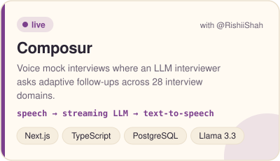
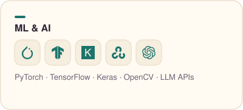
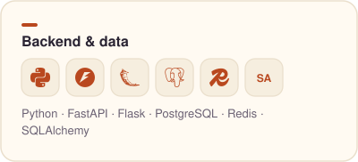
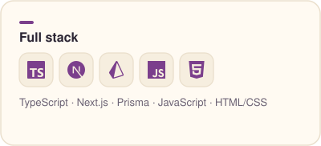
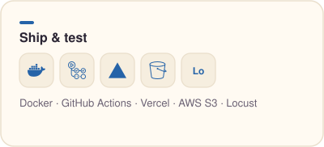
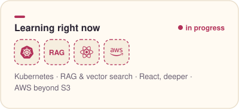

<picture>
  <source media="(prefers-color-scheme: dark)" srcset="assets/header-dark.svg">
  
</picture>

## Hey, I'm Om.

I'm a computer science master's student at Rutgers University–New Brunswick, graduating in May 2027. I work mostly on machine learning, plus the backend and frontend that put a model in front of real people.

I learn by building something and then measuring it. I load-test my own APIs until something breaks, benchmark my models against the baselines, and treat the numbers as the to-do list. That's how EventPass went from freezing at 13 requests a second to serving about 950.

Before grad school I did research on deep learning for satellite imagery, which led to an IEEE paper. Before that, I wrote firmware that read cryogenic liquid levels from noisy sensors. I like problems where software meets the messy real world.

**Open to roles starting May 2027:** full-time, part-time or internship, in ML, backend or full stack.

[Selected work](#selected-work) · [Tech stack](#tech-stack) · [Recent activity](#recent-activity) · [Get in touch](#get-in-touch)

### Now building

- **A RAG project:** LLM answers grounded in real documents, with retrieval quality I can actually measure.
- **My portfolio site**, coming right after this page.

## Selected work

<!-- PROJECTS:START -->

  <a href="https://github.com/Ompatel179/Eventpass"><picture><source media="(prefers-color-scheme: dark)" srcset="assets/card-eventpass-dark.svg"></picture></a>
  <a href="https://github.com/Ompatel179/Harnessing_Generative_Adversarial_Models_to_Enhance_Satellite_Imagery_Quality"><picture><source media="(prefers-color-scheme: dark)" srcset="assets/card-satellite-srgan-dark.svg"></picture></a>

  <a href="https://composur.tech"><picture><source media="(prefers-color-scheme: dark)" srcset="assets/card-composur-dark.svg"></picture></a>
  <picture><source media="(prefers-color-scheme: dark)" srcset="assets/card-rag-project-dark.svg"></picture>

<b>EventPass</b> <a href="https://github.com/Ompatel179/Eventpass">code</a> &nbsp;|&nbsp; <b>Satellite SRGAN</b> <a href="https://github.com/Ompatel179/Harnessing_Generative_Adversarial_Models_to_Enhance_Satellite_Imagery_Quality">code</a> &nbsp;|&nbsp; <b>Composur</b> <a href="https://composur.tech">live demo</a> · built with <a href="https://github.com/RishiiShah">@RishiiShah</a>

<!-- PROJECTS:END -->

<b>More projects</b>

 

<!-- MORE:START -->
- **[Jobnova agents](https://github.com/Ompatel179/Jobnova)**: Take-home for an AI engineer role: a Playwright agent that finds companies' career pages and open roles, plus a Chrome extension that fills Lever applications from a profile.  
  Python · Flask · Playwright · Chrome extension (MV3)
- **[Plant disease prediction](https://github.com/Ompatel179/Plant_disease_prediction)**: CNN that identifies plant diseases from leaf photos, with a Streamlit app for predictions.  
  TensorFlow · Keras · OpenCV · Streamlit
<!-- MORE:END -->

## Tech stack

  <picture><source media="(prefers-color-scheme: dark)" srcset="assets/panel-ml-ai-dark.svg"></picture>
  <picture><source media="(prefers-color-scheme: dark)" srcset="assets/panel-backend-data-dark.svg"></picture>

  <picture><source media="(prefers-color-scheme: dark)" srcset="assets/panel-full-stack-dark.svg"></picture>
  <picture><source media="(prefers-color-scheme: dark)" srcset="assets/panel-ship-test-dark.svg"></picture>

  <picture><source media="(prefers-color-scheme: dark)" srcset="assets/panel-learning-dark.svg"></picture>
  <picture><source media="(prefers-color-scheme: dark)" srcset="assets/panel-languages-dark.svg"></picture>

<b>How I'm learning the in-progress ones</b>

 

I build something small with each one, so it ends up in a repo and not just in my notes.

- **RAG and vector search:** chunking, embeddings and retrieval evaluation, all going into the RAG project above.
- **Kubernetes:** taking EventPass from Docker Compose to a small cluster deployment.
- **React, deeper:** state, data fetching and component design beyond what Next.js gave me in Composur.
- **AWS beyond S3:** compute and deployment services, so I can host my own projects end to end.

<b>More about me</b>

 

- MS in Computer Science at **Rutgers University–New Brunswick** (graduating May 2027). B.Tech in ICT from PDEU, India.
- Published **"Harnessing Generative Adversarial Models to Enhance Satellite Imagery Quality"** at IEEE ICETA 2025.
- Research intern in deep learning: U-Nets for change detection on satellite imagery (89% IoU).
- Part-time at Rutgers Career Exploration and Success: I build an internal web dashboard for employers and wrote the mentor–mentee matching algorithm. That code isn't public, which is why this page shows only personal projects.

## Recent activity

<!-- ACTIVITY:START -->
- Merged PR [#16](https://github.com/Ompatel179/Eventpass/pull/16) *Enforce event capacity with a row lock, fix ticket card bug, update README with screenshots* in [Eventpass](https://github.com/Ompatel179/Eventpass) ·&nbsp;Nov&nbsp;12
- Merged PR [#15](https://github.com/Ompatel179/Eventpass/pull/15) *Add full website: public events, sign-up, tickets, organizer dashboard, shared scanner login* in [Eventpass](https://github.com/Ompatel179/Eventpass) ·&nbsp;Nov&nbsp;12
- Merged PR [#14](https://github.com/Ompatel179/Eventpass/pull/14) *Store all times as timestamptz and require time zones in the API* in [Eventpass](https://github.com/Ompatel179/Eventpass) ·&nbsp;Nov&nbsp;12
- Merged PR [#13](https://github.com/Ompatel179/Eventpass/pull/13) *Add README with architecture, design decisions and load-test results* in [Eventpass](https://github.com/Ompatel179/Eventpass) ·&nbsp;Nov&nbsp;09
- Merged PR [#12](https://github.com/Ompatel179/Eventpass/pull/12) *Index registrations by user* in [Eventpass](https://github.com/Ompatel179/Eventpass) ·&nbsp;Nov&nbsp;09
<!-- ACTIVITY:END -->

## Get in touch

I'm happy to talk about ML systems, backend performance, or a role you think I'd fit.

- LinkedIn: [linkedin.com/in/op179](https://www.linkedin.com/in/op179/)
- Email: [omnpatel179@gmail.com](mailto:omnpatel179@gmail.com)
- Resumes: [ML / AI](resume/Om_Patel_Resume_ML_AI.pdf) · [Software engineering](resume/Om_Patel_Resume_SWE.pdf) · [Forward-deployed engineering](resume/Om_Patel_Resume_FDE.pdf)
<!-- PORTFOLIO: replace the line below with "- Portfolio: [your-site](https://your-site)" once it's live -->
- Portfolio: coming soon

Refreshed daily by a GitHub Action. Icons from [Simple Icons](https://simpleicons.org) (CC0).
