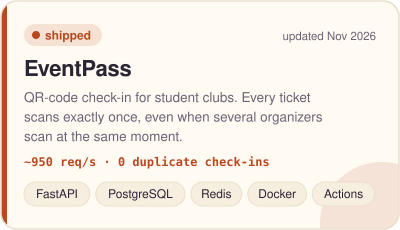
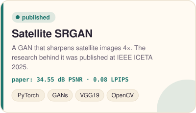
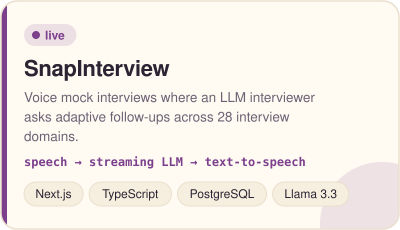
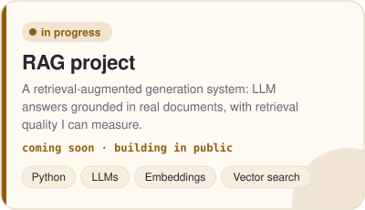
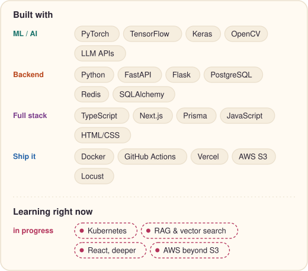

<picture>
  <source media="(prefers-color-scheme: dark)" srcset="assets/header-dark.svg">
  
</picture>

I learn by building things and then measuring them: load-testing my own APIs, benchmarking my own models, fixing what the numbers expose. I mostly work in ML, with the backend and frontend that put a model in front of people.

**Open to roles starting May 2027:** full-time, part-time or internship, in ML, backend or full stack.
[LinkedIn](https://www.linkedin.com/in/op179/) · [Email](mailto:omnpatel179@gmail.com) · [Resume](resume/Om_Patel_Resume_ML_AI.pdf)

### Now building

- **A RAG project:** LLM answers grounded in real documents, with retrieval quality I can actually measure. It replaces the placeholder card below when it ships.
- **My portfolio site**, coming right after this page.

### Featured projects

<!-- PROJECTS:START -->

  <a href="https://github.com/Ompatel179/Eventpass"><picture><source media="(prefers-color-scheme: dark)" srcset="assets/card-eventpass-dark.svg"></picture></a>
  <picture><source media="(prefers-color-scheme: dark)" srcset="assets/card-satellite-srgan-dark.svg"></picture>

  <a href="https://snapinterview.app"><picture><source media="(prefers-color-scheme: dark)" srcset="assets/card-snapinterview-dark.svg"></picture></a>
  <picture><source media="(prefers-color-scheme: dark)" srcset="assets/card-rag-project-dark.svg"></picture>

<b>EventPass</b> <a href="https://github.com/Ompatel179/Eventpass">code</a> &nbsp;|&nbsp; <b>SnapInterview</b> <a href="https://snapinterview.app">live demo</a>

<!-- PROJECTS:END -->

### Tech stack

<picture>
  <source media="(prefers-color-scheme: dark)" srcset="assets/stack-dark.svg">
  
</picture>

<b>More projects</b>

 

<!-- MORE:START -->
- **[Jobnova agents](https://github.com/Ompatel179/Jobnova)**: Take-home for an AI engineer role: a Playwright agent that finds companies' career pages and open roles, plus a Chrome extension that fills Lever applications from a profile.  
  Python · Flask · Playwright · Chrome extension (MV3)
- **[Plant disease prediction](https://github.com/Ompatel179/Plant_disease_prediction)**: CNN that identifies plant diseases from leaf photos, with a Streamlit app for predictions.  
  TensorFlow · Keras · OpenCV · Streamlit
<!-- MORE:END -->

<b>What I'm learning</b>

 

I keep a short list and build something small with each item, so it ends up in a repo and not just in my notes.

- **RAG and vector search:** chunking, embeddings and retrieval evaluation, all going into the RAG project above.
- **Kubernetes:** taking EventPass from Docker Compose to a small cluster deployment.
- **React, deeper:** state, data fetching and component design beyond what Next.js gave me in SnapInterview.
- **AWS beyond S3:** compute and deployment services, so I can host my own projects end to end.

<b>About me</b>

 

- MS in Computer Science at **Rutgers University–New Brunswick** (graduating May 2027). B.Tech in ICT from PDEU, India.
- Published **"Harnessing Generative Adversarial Models to Enhance Satellite Imagery Quality"** at IEEE ICETA 2025.
- Research intern in deep learning: U-Nets for change detection on satellite imagery (89% IoU).
- Part-time at Rutgers Career Exploration and Success: I build an internal web dashboard for employers and wrote the mentor–mentee matching algorithm. That code isn't public, which is why this page shows only personal projects.
- Before all that I wrote ESP32 firmware that estimated cryogenic liquid levels from noisy sensors. I still like it when software touches the physical world.

### Recent activity

<!-- ACTIVITY:START -->
- Merged PR [#16](https://github.com/Ompatel179/Eventpass/pull/16) *Enforce event capacity with a row lock, fix ticket card bug, update README with screenshots* in [Eventpass](https://github.com/Ompatel179/Eventpass) ·&nbsp;Nov&nbsp;12
- Merged PR [#15](https://github.com/Ompatel179/Eventpass/pull/15) *Add full website: public events, sign-up, tickets, organizer dashboard, shared scanner login* in [Eventpass](https://github.com/Ompatel179/Eventpass) ·&nbsp;Nov&nbsp;12
- Merged PR [#14](https://github.com/Ompatel179/Eventpass/pull/14) *Store all times as timestamptz and require time zones in the API* in [Eventpass](https://github.com/Ompatel179/Eventpass) ·&nbsp;Nov&nbsp;12
- Merged PR [#13](https://github.com/Ompatel179/Eventpass/pull/13) *Add README with architecture, design decisions and load-test results* in [Eventpass](https://github.com/Ompatel179/Eventpass) ·&nbsp;Nov&nbsp;09
- Merged PR [#12](https://github.com/Ompatel179/Eventpass/pull/12) *Index registrations by user* in [Eventpass](https://github.com/Ompatel179/Eventpass) ·&nbsp;Nov&nbsp;09
<!-- ACTIVITY:END -->

### Say hi

[LinkedIn](https://www.linkedin.com/in/op179/) · [omnpatel179@gmail.com](mailto:omnpatel179@gmail.com) · Resumes: [ML / AI](resume/Om_Patel_Resume_ML_AI.pdf) · [Software engineering](resume/Om_Patel_Resume_SWE.pdf) · [Forward-deployed engineering](resume/Om_Patel_Resume_FDE.pdf)
<!-- PORTFOLIO: replace the line below with [Portfolio](https://your-site) once it's live -->
Portfolio: coming soon
